# ETS PBKK — Booking Kampus

| Nama | NRP | Mata Kuliah | Kelas |
|---|---|---|---|
| Willy Marcelius | 5025241096 | Pemrograman Berbasis Kerangka Kerja | D |

## Informasi ETS

**Topik:** Sistem Informasi Booking Ruangan & Fasilitas Kampus

**Video demo:** 
```bash
https://youtu.be/jzrz0WBJIos
```

## Aplikasi Desktop Booking Kampus

Aplikasi desktop berbasis **C# WPF** untuk mengajukan pemakaian ruangan dan fasilitas kampus. Mahasiswa dapat memeriksa jadwal, mengirim booking, dan melihat status pengajuan. Administrator mengelola data ruangan dan fasilitas serta memproses persetujuan.

Dokumen kebutuhan produk: [PRD Booking Kampus](./PRD%20Booking%20Kampus.pdf)

## Ringkasan Aplikasi

Booking Kampus memusatkan alur pemesanan ruangan dari pengajuan sampai persetujuan. Setiap pengajuan memiliki tanggal, waktu mulai dan selesai, keperluan, serta fasilitas opsional. Jadwal ruangan menampilkan booking yang menunggu maupun yang telah disetujui.

Booking aktif pada ruangan dan tanggal yang sama tidak boleh memiliki waktu yang bertumpang tindih. Slot yang sedang menunggu persetujuan menahan jadwal sementara; booking yang ditolak atau dibatalkan tidak lagi menahan slot.

## Arsitektur Aplikasi

Aplikasi memakai pola **MVVM**. ViewModel memanggil service untuk aturan bisnis, lalu repository menjalankan query SQL Server menggunakan ADO.NET.

```text
┌─────────────────────────────────────────────────────────────┐
│ View (WPF/XAML)                                             │
│ LoginWindow, MainWindow, BookingView, ApprovalView, dll.    │
└──────────────────────────┬──────────────────────────────────┘
                           │ Binding dan Command
┌──────────────────────────▼──────────────────────────────────┐
│ ViewModel                                                   │
│ State halaman, validasi, command, dan pemuatan data         │
└──────────────────────────┬──────────────────────────────────┘
                           │ memanggil service/repository
┌──────────────────────────▼──────────────────────────────────┐
│ Service dan Repository                                      │
│ Aturan bisnis, otorisasi, query berparameter, transaksi     │
└──────────────────────────┬──────────────────────────────────┘
                           │ ADO.NET
┌──────────────────────────▼──────────────────────────────────┐
│ SQL Server                                                  │
│ BookingKampusDB                                              │
└─────────────────────────────────────────────────────────────┘
       Model digunakan bersama oleh lapisan aplikasi
```

## Fitur Aplikasi

| Fitur | Deskripsi | Kebutuhan PRD |
|---|---|---|
| Login dan hak akses | Login menggunakan akun aktif; menu dan aksi dibatasi berdasarkan peran Admin atau Pemohon. | FR-01–FR-03 |
| Dashboard | Menampilkan jumlah booking menunggu, ruangan aktif, fasilitas aktif, booking disetujui bulan ini, dan jadwal disetujui hari ini. | FR-04–FR-05 |
| Ruangan | Melihat dan mencari ruangan berdasarkan kode, nama, atau gedung. Administrator dapat menambah, mengubah, menghapus, mengatur status aktif, dan memilih fasilitas. | FR-06–FR-08 |
| Fasilitas | Melihat dan mencari fasilitas. Administrator dapat mengelola nama, deskripsi, dan status aktif. | FR-09–FR-11 |
| Pengajuan booking | Memilih ruangan, tanggal, jam mulai/selesai, keperluan, dan fasilitas yang tersedia. | FR-13–FR-15 |
| Jadwal ruangan | Melihat booking berstatus Menunggu dan Disetujui untuk ruangan serta tanggal pilihan. | FR-12, FR-16 |
| Booking saya | Memeriksa status dan catatan administrator serta membatalkan booking sendiri yang masih dapat dibatalkan. | FR-17–FR-18 |
| Persetujuan | Administrator meninjau detail booking, menyetujui pengajuan, atau menolak dengan alasan. | FR-19–FR-21 |
| Validasi dan pesan | Validasi input, pesan hasil aksi, state data kosong, dan penanganan kesalahan. | FR-22 |

## Aturan Booking

- Jam operasional booking: **07.00–21.00** dengan pilihan waktu per 30 menit.
- Tanggal booking tidak boleh di masa lalu. Untuk booking hari ini, jam mulai tidak boleh sudah lewat.
- Jam selesai harus setelah jam mulai.
- Keperluan wajib diisi, minimal 5 dan maksimal 200 karakter.
- Sistem menolak waktu yang bertumpang tindih dengan booking Menunggu atau Disetujui pada ruangan dan tanggal yang sama. Jam yang berdampingan diperbolehkan, misalnya 08.00–10.00 dan 10.00–11.00.
- Booking baru berstatus **Menunggu**. Administrator dapat menyetujui atau menolak; alasan penolakan wajib diisi.
- Pemohon dapat membatalkan booking miliknya yang berstatus Menunggu atau Disetujui.

## Schema Database

Database menggunakan SQL Server dengan nama awal `BookingKampusDB`. Skema, constraint, index, dan data contoh terdapat di `Database/schema.sql` dan diterapkan otomatis saat aplikasi mulai.

| Tabel | Kolom utama | Keterangan |
|---|---|---|
| Users | UserId, Username, PasswordHash, Nama, Email, Role, IsActive | Akun pengguna, hash kata sandi, dan peran. |
| Ruangan | RuanganId, Kode, Nama, Gedung, Lantai, Kapasitas, Deskripsi, IsActive | Informasi lokasi dan kapasitas ruangan. |
| Fasilitas | FasilitasId, Nama, Deskripsi, IsActive | Katalog fasilitas. |
| RuanganFasilitas | RuanganId, FasilitasId | Fasilitas yang tersedia pada suatu ruangan. |
| Booking | BookingId, UserId, RuanganId, Tanggal, JamMulai, JamSelesai, Keperluan, Status, CatatanApprover, CreatedAt | Pengajuan dan status pemakaian ruangan. |
| BookingFasilitas | BookingId, FasilitasId | Fasilitas yang diminta untuk suatu booking. |

Relasi utama:

```text
Users       1 ───── * Booking
Ruangan     1 ───── * Booking
Ruangan     1 ───── * RuanganFasilitas * ───── 1 Fasilitas
Booking     1 ───── * BookingFasilitas * ───── 1 Fasilitas
```

Status booking yang digunakan: `Menunggu`, `Disetujui`, `Ditolak`, dan `Dibatalkan`. Username, kode ruangan, dan nama fasilitas memiliki constraint unik. Relasi menggunakan foreign key.

## Build dan Menjalankan Aplikasi

### Prasyarat

- Windows dengan .NET 8 SDK / .NET Desktop Runtime yang sesuai.
- SQL Server lokal yang sedang berjalan.
- Akun SQL Server yang dapat membuat database saat pertama kali aplikasi dijalankan.

### Langkah menjalankan

1. Pastikan connection string pada `appsettings.json` menunjuk ke instance SQL Server yang tersedia. Nilai bawaan menggunakan `localhost`, Windows Authentication, dan database `BookingKampusDB`.
2. Buka terminal pada folder `ETS`, lalu jalankan:

   ```powershell
   dotnet build
   dotnet run
   ```

3. Saat pertama kali dijalankan, aplikasi membuat database, tabel, fasilitas dan ruangan contoh. Akun demo dibuat jika tabel `Users` masih kosong.
4. Masuk menggunakan akun yang tersedia pada lingkungan demo.

## Tampilan Aplikasi

1. **Login** — halaman login sebelum pengguna masuk.

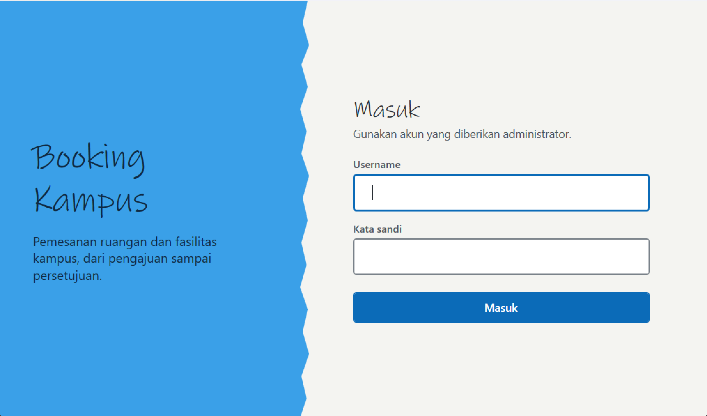

2. **Dashboard** — kartu statistik dan jadwal hari ini.

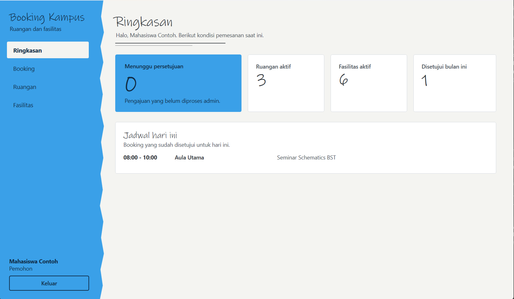

3. **Katalog ruangan** — daftar ruangan dengan lokasi, kapasitas, fasilitas, dan status.

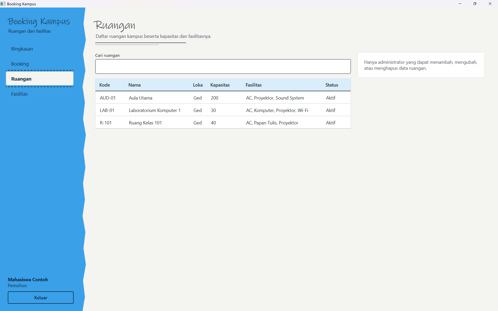

4. **Form booking** — ruangan dan tanggal terpilih, pilihan jam/fasilitas, serta jadwal yang sudah terisi.

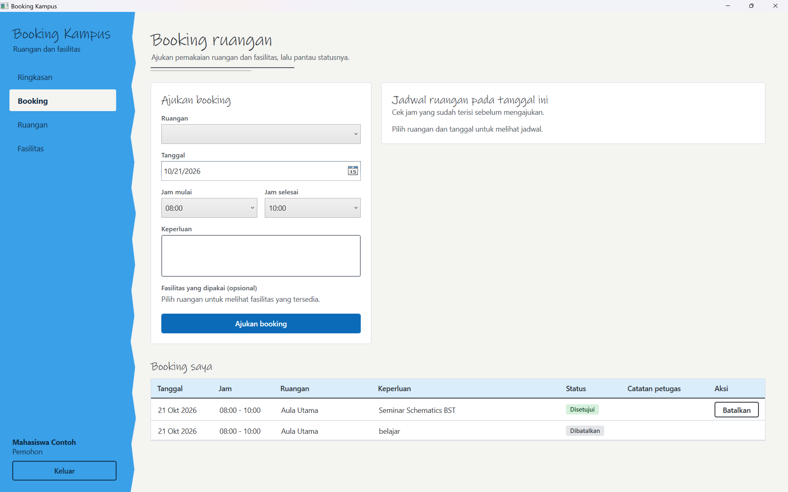

5. **Booking berhasil** — daftar “Booking saya” menampilkan pengajuan berstatus Menunggu.


6. **Validasi bentrok** — pesan saat mencoba mengajukan jam yang bertumpang tindih dengan booking aktif.

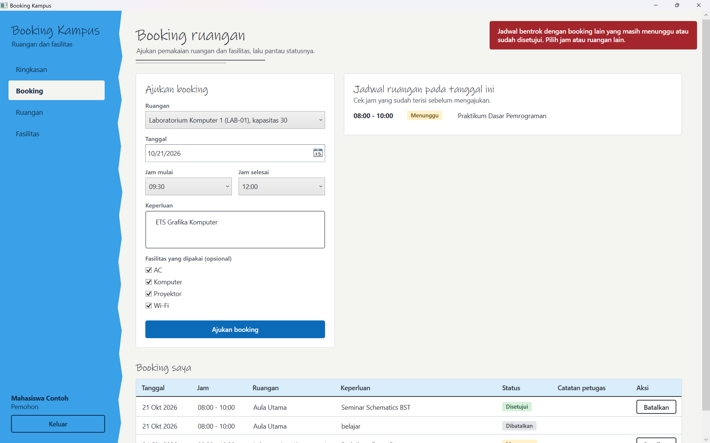

7. **Persetujuan administrator** — antrean dan panel detail pengajuan sebelum diproses.

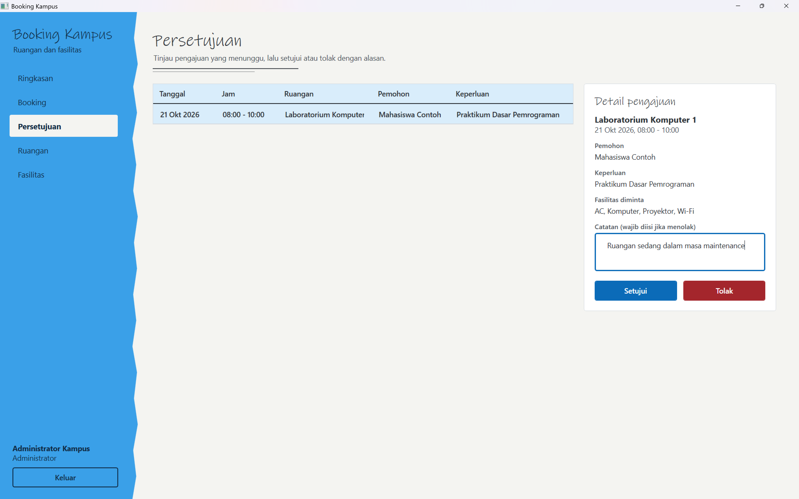

8. **Hasil keputusan pada Booking saya (tampilan pemohon)** — status Disetujui atau Ditolak dan catatan administrator yang tampil setelah pengajuan diproses.

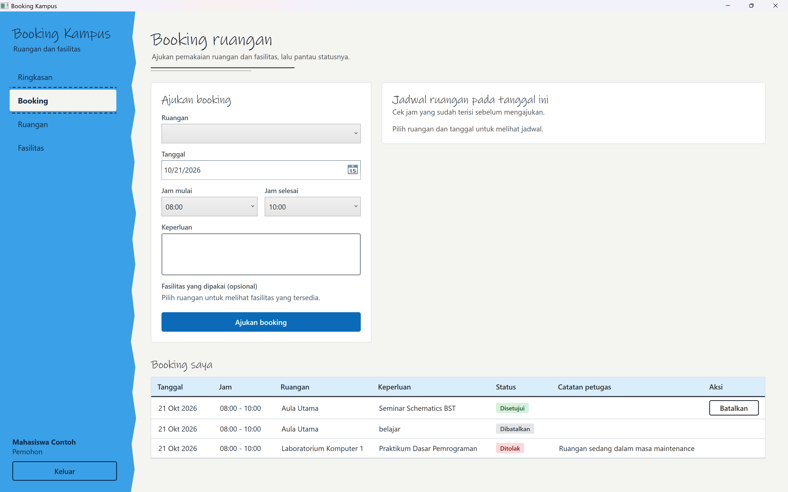

9. **Pengelolaan data master** — tampilan form tambah/ubah ruangan beserta fasilitas, serta pengelolaan fasilitas.


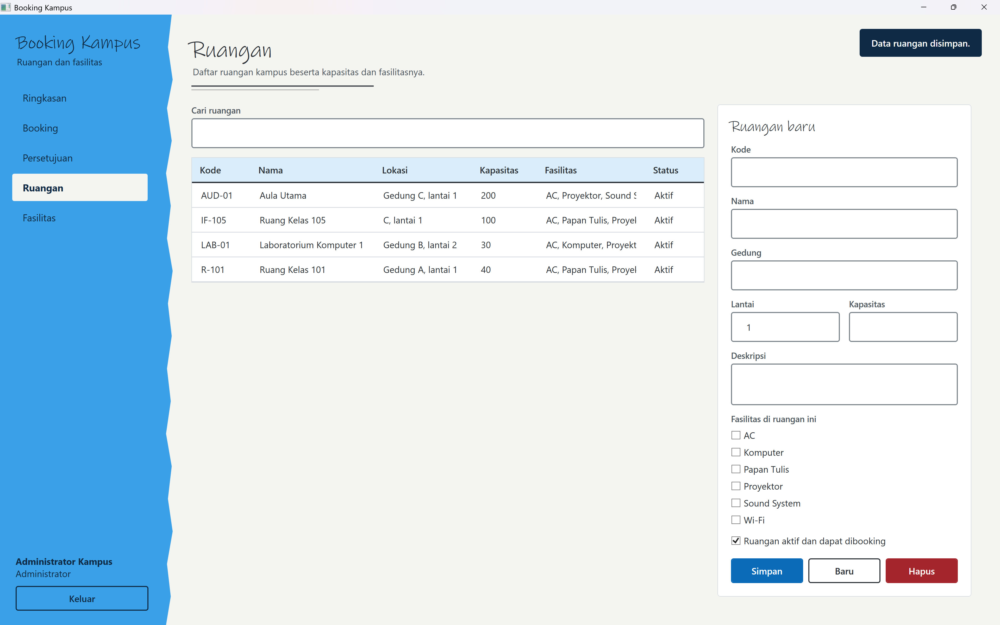

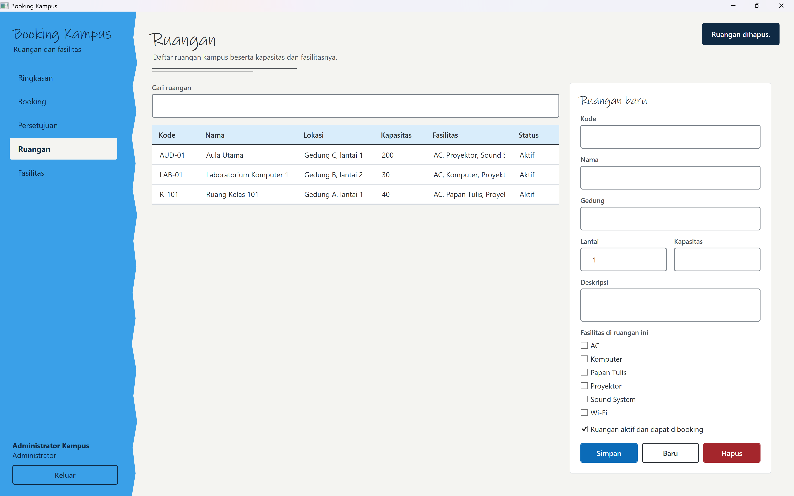

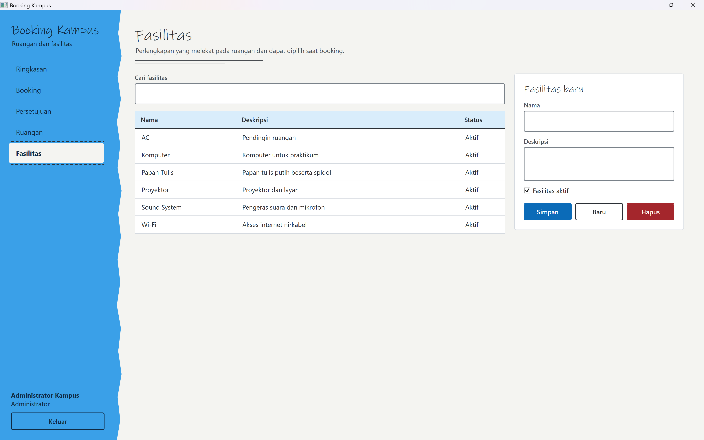

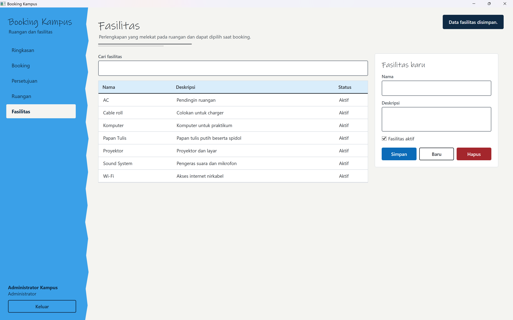

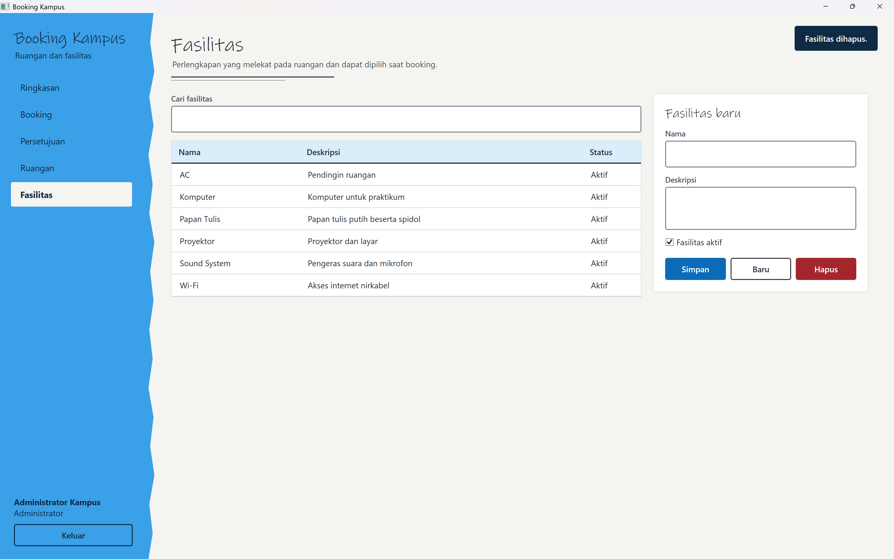

10. **Validasi input** — contoh pesan saat input wajib kosong atau tidak valid.

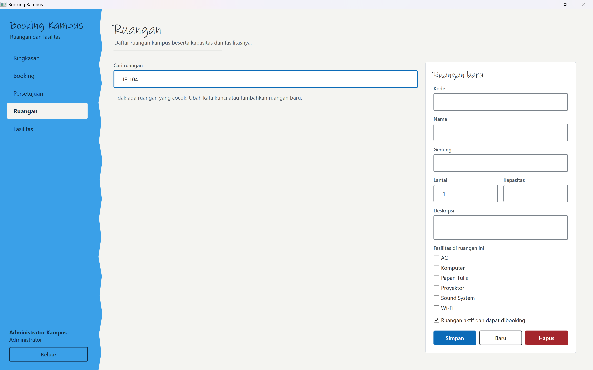

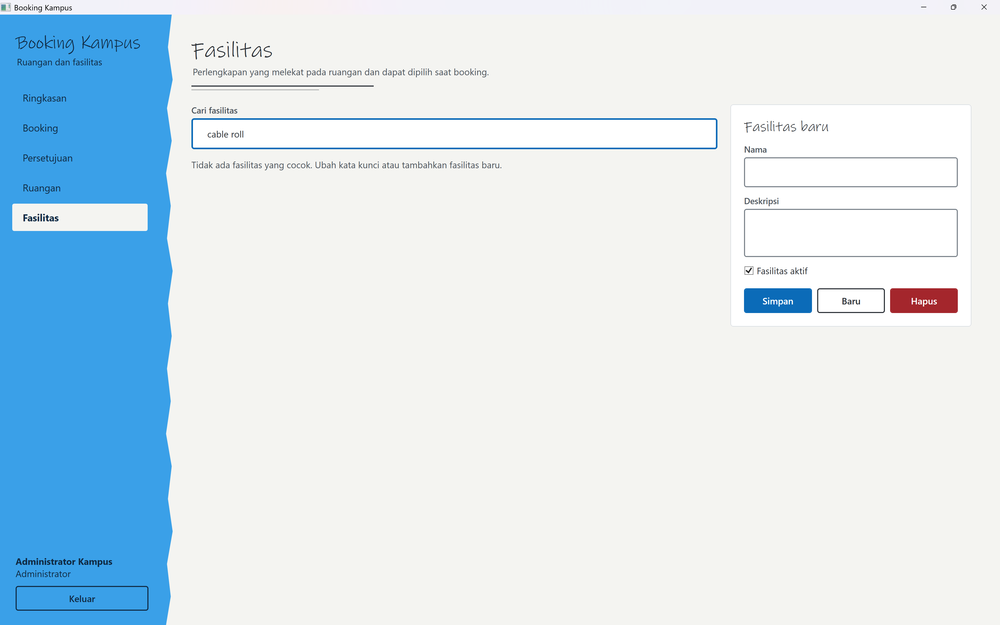

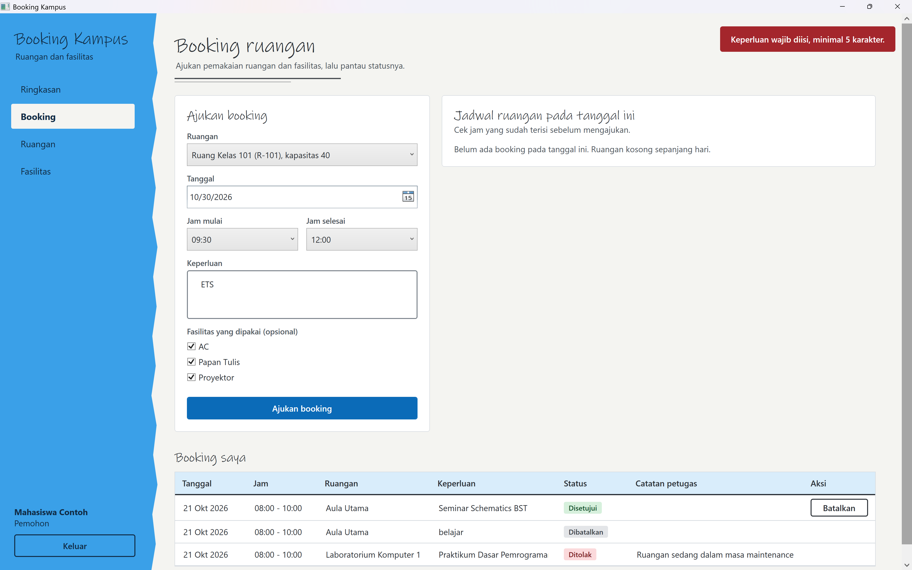

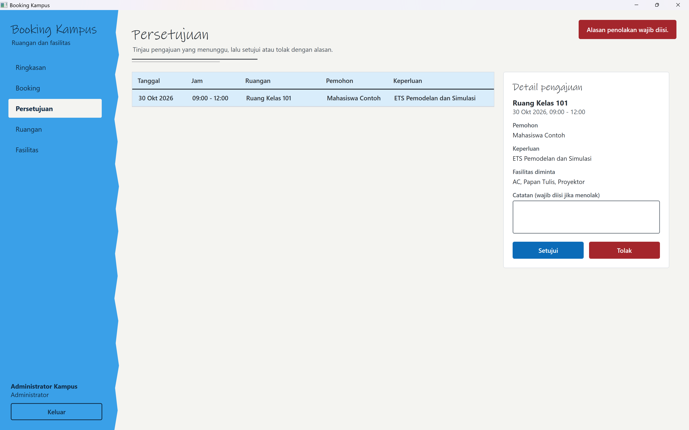

## Penjelasan Kode

Kode sumber aplikasi berada di folder `ETS` dan dipisah berdasarkan tanggung jawab.

| Lapisan / Folder | Isi |
|---|---|
| `Views` | Jendela dan halaman WPF/XAML untuk login, dashboard, booking, persetujuan, ruangan, dan fasilitas. |
| `ViewModels` | State tampilan, command, pemuatan data, dan interaksi dengan service/repository. |
| `Models` | Entitas pengguna, ruangan, fasilitas, booking, dan status. |
| `Services` | Autentikasi, aturan booking, inisialisasi database, validasi dan otorisasi. |
| `Repositories` | Query database, pemetaan hasil SQL, dan operasi CRUD. |
| `Helpers` | Akses database, sesi, konfigurasi, konverter, dialog, toast, dan logging. |
| `Resources` | Tema visual dan style WPF yang digunakan bersama. |
| `Database/schema.sql` | Pembuatan tabel, constraint, index, serta data awal ruangan dan fasilitas. |

File penting:

- `App.xaml` dan `App.xaml.cs` — memuat resource, membaca konfigurasi, menyiapkan database, dan membuka halaman login.
- `BookingKampus.App.csproj` — menargetkan `net8.0-windows`, mengaktifkan WPF, dan mendeklarasikan dependency aplikasi.
- `Services/BookingService.cs` — memvalidasi pengajuan, bentrok jadwal, pembatalan, persetujuan, dan penolakan.
- `Repositories/BookingRepository.cs` — membaca jadwal, menyimpan booking, dan memperbarui status.
- `Helpers/Db.cs` — menjalankan query SQL berparameter melalui `Microsoft.Data.SqlClient`.
- `Helpers/Logger.cs` — mencatat error teknis di folder data aplikasi pengguna Windows.

Kata sandi akun disimpan sebagai hash BCrypt. Operasi database menggunakan parameter SQL, sedangkan operasi yang berpotensi lama dijalankan secara asynchronous.