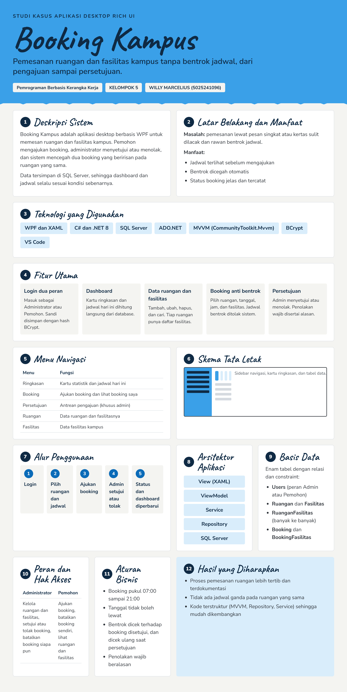

# ETS PBKK — Booking Kampus

| Nama | NRP | Mata Kuliah | Kelas |
|---|---|---|---|
| Willy Marcelius | 5025241096 | Pemrograman Berbasis Kerangka Kerja | D |

## Soal

1. Jelaskan deskripsi dan ruang lingkup fitur aplikasi Desktop Rich UI yang dibuat.
2. Apa latar belakang dan manfaat aplikasi tersebut dibuat?
3. Buat poster infografis aplikasi yang telah dibuat dalam satu halaman.

## Jawaban

### 1. Deskripsi dan Ruang Lingkup Fitur

Booking Kampus adalah aplikasi desktop Rich UI berbasis WPF (C# dan XAML) dengan SQL Server untuk memesan ruangan dan fasilitas kampus tanpa bentrok jadwal. Pemohon mengajukan booking, lalu administrator menyetujui atau menolaknya.

Ruang lingkup fitur aplikasi:

- Login dengan dua peran, yaitu Administrator dan Pemohon.
- Dashboard berisi ringkasan dan jadwal hari ini dari database.
- Pengelolaan data ruangan dan fasilitas: tambah, ubah, hapus, dan cari.
- Pengajuan booking dengan pilihan fasilitas dan deteksi bentrok jadwal otomatis.
- Persetujuan atau penolakan pengajuan oleh administrator, serta pembatalan booking oleh pemohon.

### 2. Latar Belakang dan Manfaat

**Latar belakang:** Pemesanan ruangan lewat pesan singkat atau kertas sulit dilacak dan rawan bentrok jadwal. Aplikasi ini menyatukan pengajuan, pengecekan jadwal, dan persetujuan dalam satu sistem.

**Manfaat:**

1. Jadwal ruangan dapat dilihat sebelum pemohon mengajukan booking.
2. Bentrok jadwal dicegah secara otomatis.
3. Status booking jelas dan tercatat.
4. Data ruangan dan fasilitas terpusat serta mudah dikelola.

### 3. Poster Infografis

