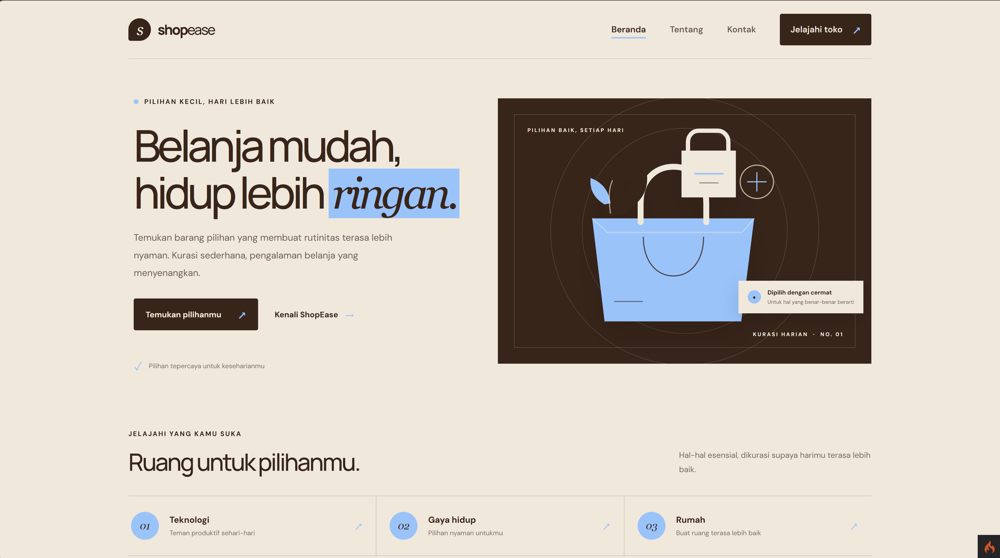
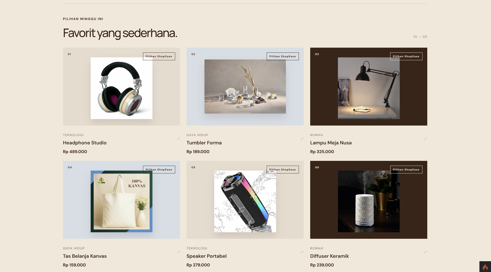
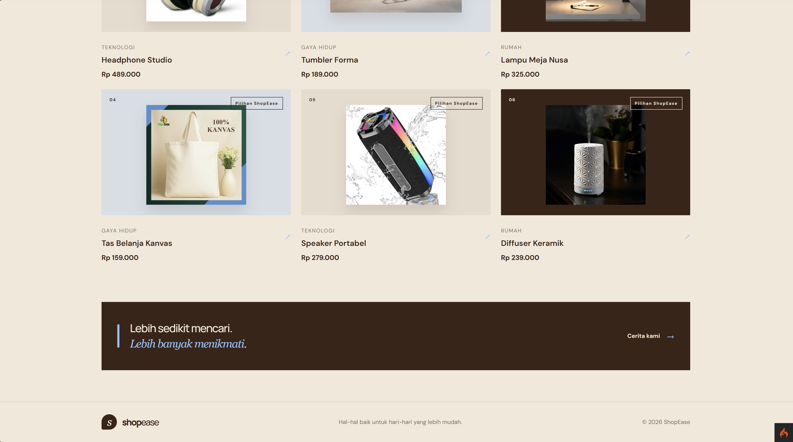
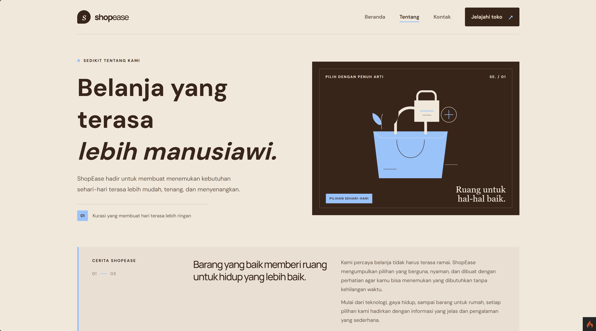
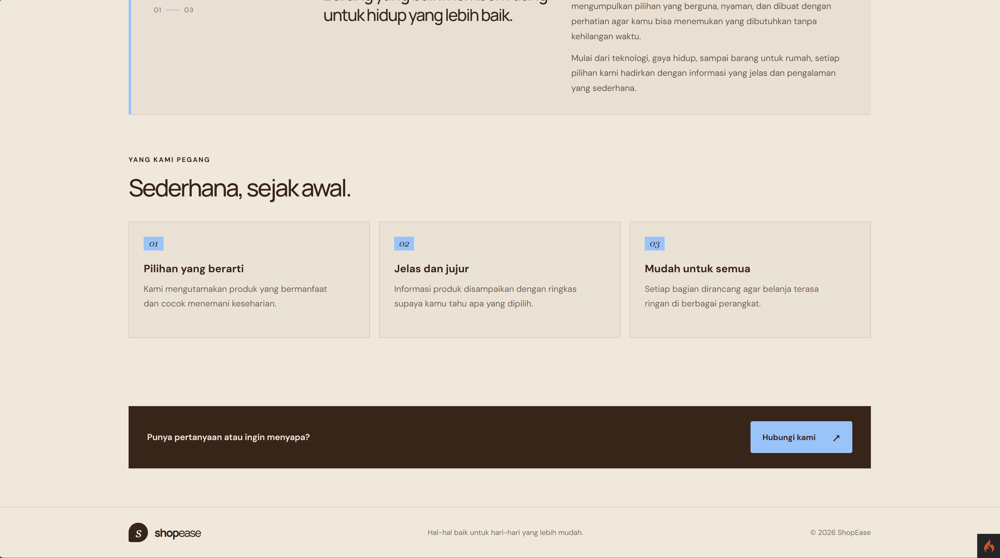
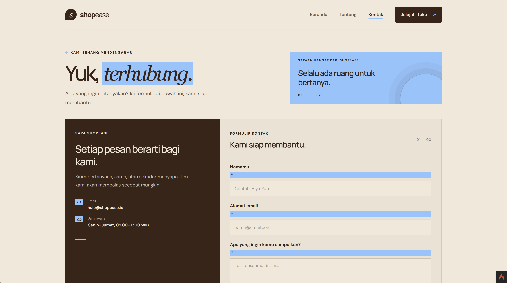
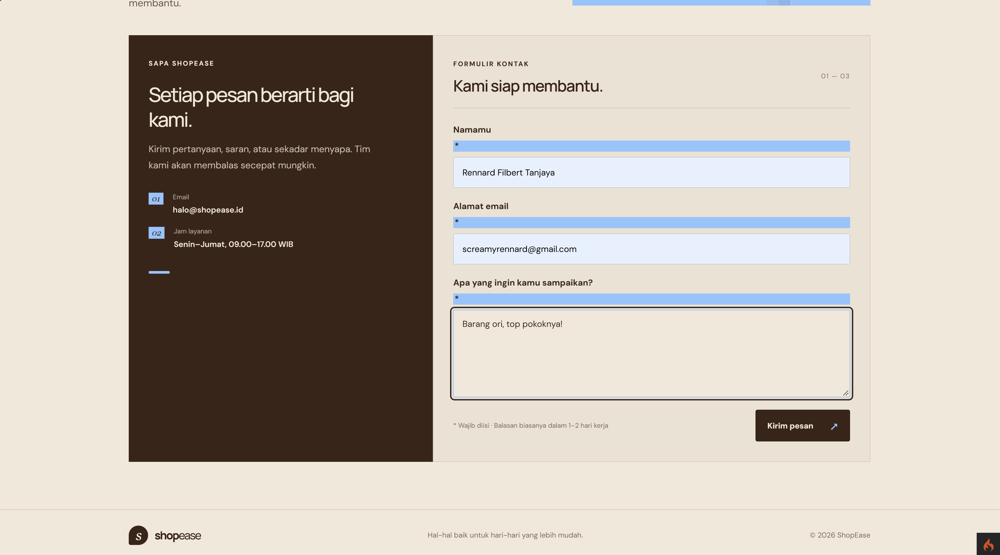
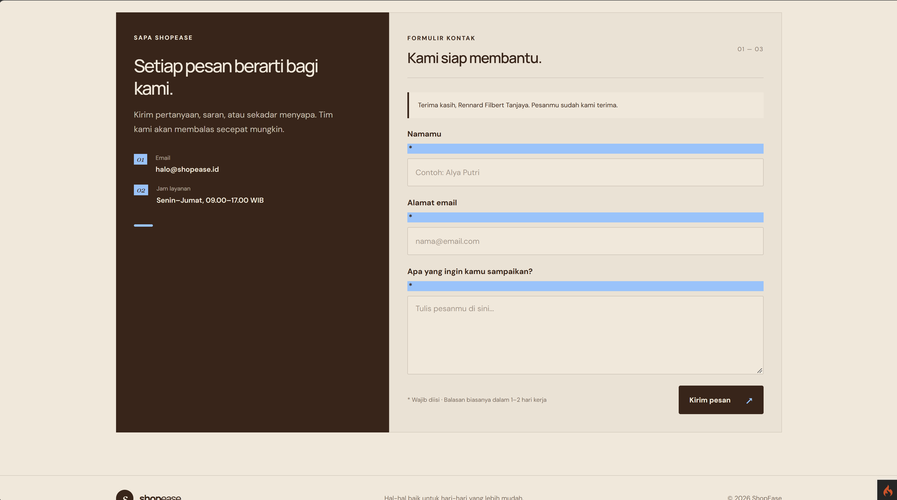

# Latihan Pertemuan 10 PBKK: ShopEase


| Nama | NRP | Mata Kuliah | Kelas |
|---|---|---|---|
| Willy Marcelius | 5025241096 | Pemrograman Berbasis Kerangka Kerja | D |

---

## 1. Deskripsi

**ShopEase** adalah rancangan halaman awal toko online untuk membantu pengunjung menemukan barang pilihan untuk kebutuhan sehari-hari. Latihan ini menerapkan **Routing, Controller, dan View** pada CodeIgniter 4 melalui tiga halaman: Beranda, Tentang, dan Kontak.

Data kategori dan enam produk contoh disiapkan langsung di controller. Proyek ini belum memakai database.

| Halaman | URL | Isi |
|---|---|---|
| Beranda | `/` | Hero, kategori, dan enam produk pilihan |
| Tentang | `/about` | Cerita dan nilai ShopEase |
| Kontak | `/contact` | Informasi kontak dan formulir pesan |

## 2. Alur MVC

Routing memilih controller berdasarkan URL. Controller menyiapkan data atau memvalidasi input, lalu view menyusun respons HTML yang ditampilkan kepada pengguna.

```text
Browser → Routes.php → Controller → View → HTML
```

Contoh: ketika pengguna membuka `/about`, CodeIgniter mencocokkan route `about`, menjalankan `AboutController::index()`, lalu menampilkan `app/Views/frontend/about.php` di dalam layout utama.

## 3. Lingkungan dan Persiapan

Persyaratan aplikasi:

- PHP 8.2 atau lebih baru
- Composer
- CodeIgniter 4.7.6

Proyek belum membutuhkan database. Dependensi berada di folder `vendor`; jika folder itu belum tersedia, buka terminal pada folder proyek dan jalankan:

```bash
composer install
```

Salin `.env.example` menjadi `.env` untuk menyiapkan environment lokal.

## 4. Routing

Auto-routing dinonaktifkan agar setiap URL dan method HTTP didaftarkan secara eksplisit. Route memiliki nama sehingga tautan pada view dapat dibuat menggunakan `url_to()`.

| Method | URL | Nama Route | Controller dan Method |
|---|---|---|---|
| GET | `/` | `home` | `Home::index` |
| GET | `/about` | `about` | `AboutController::index` |
| GET | `/contact` | `contact` | `ContactController::index` |
| POST | `/contact/send` | `contact.send` | `ContactController::send` |

Konfigurasi route utama di `app/Config/Routes.php`:

```php
$routes->setAutoRoute(false);

$routes->get('/', 'Home::index', ['as' => 'home']);
$routes->get('about', 'AboutController::index', ['as' => 'about']);
$routes->get('contact', 'ContactController::index', ['as' => 'contact']);
$routes->post('contact/send', 'ContactController::send', ['as' => 'contact.send']);
```

## 5. Controller dan View

| Controller | Method | View | Tanggung jawab |
|---|---|---|---|
| `Home` | `index()` | `frontend/home.php` | Mengirim kategori dan enam data produk ke halaman Beranda |
| `AboutController` | `index()` | `frontend/about.php` | Menampilkan cerita dan nilai ShopEase |
| `ContactController` | `index()` | `frontend/contact.php` | Menampilkan formulir kontak |
| `ContactController` | `send()` | Redirect ke Kontak | Memvalidasi formulir dan menampilkan hasilnya |

Semua halaman menggunakan `layouts/main.php`. Layout menyediakan navbar dan footer bersama, sedangkan isi setiap halaman diletakkan dalam section `content`. Data yang ditampilkan di view di-escape menggunakan `esc()`.

### Gambar produk

Enam produk beranda mengambil foto dari `public/assets/img/products/`. Jika file foto tidak tersedia, halaman memakai ilustrasi lokal sebagai fallback.

| Produk | File gambar |
|---|---|
| Headphone Studio | `headphone-studio.jpg` |
| Tumbler Forma | `tumbler-forma.jpg` |
| Lampu Meja Nusa | `lampu-meja-nusa.jpeg` |
| Tas Belanja Kanvas | `tas-belanja-kanvas.jpeg` |
| Speaker Portabel | `speaker-portabel.png` |
| Diffuser Keramik | `diffuser-keramik.jpg` |

Harga produk ditampilkan dalam format Rupiah. Data produk saat ini merupakan data contoh di `Home::index()`, bukan hasil query database.

## 6. Formulir Kontak

Formulir mengirimkan data dengan metode POST ke `/contact/send`. Filter CSRF aktif secara global di `app/Config/Filters.php` dan token formulir dibuat dengan `csrf_field()`.

Controller memvalidasi nama (3–100 karakter), email, dan pesan (10–2.000 karakter). Jika validasi gagal, pengguna kembali ke halaman kontak dengan daftar kesalahan dan nilai formulir sebelumnya. Jika valid, halaman menampilkan pesan konfirmasi. Pesan belum disimpan karena latihan ini belum menggunakan model atau database.

## 7. Desain Antarmuka

Tampilan dibuat responsif untuk layar desktop dan ponsel. Jarak antarelemen dirapikan agar halaman terasa nyaman tanpa banyak ruang kosong. Palet warna mengikuti proporsi 60/30/10:

| Porsi | Warna | Penggunaan |
|---|---|---|
| 60% | Cream `#F2E8DA` | Latar utama dan area terang |
| 30% | Brown `#3B2418` | Teks, navigasi, dan panel utama |
| 10% | Baby blue `#8EC5FF` | Aksen dan penanda visual |

## 8. Menjalankan Aplikasi

Saat pertama kali menyiapkan proyek, salin `.env.example` menjadi `.env`. Jika file `.env` sudah tersedia, lanjutkan dengan menjalankan server dari folder `Latihan 6 - Pertemuan 10`:

```powershell
Copy-Item .env.example .env
php spark serve
```

Buka `http://localhost:8080` di browser. Untuk melihat daftar route yang terdaftar, jalankan:

```bash
php spark routes
```

## 9. Dokumentasi Tampilan

### Beranda







### Tentang ShopEase





### Kontak








## 10. Struktur Proyek

```text
Latihan 6 - Pertemuan 10/
├── app/
│   ├── Config/
│   │   ├── Filters.php
│   │   └── Routes.php
│   ├── Controllers/
│   │   ├── AboutController.php
│   │   ├── ContactController.php
│   │   └── Home.php
│   └── Views/
│       ├── frontend/
│       │   ├── about.php
│       │   ├── contact.php
│       │   └── home.php
│       ├── layouts/main.php
│       └── partials/
│           ├── footer.php
│           └── navbar.php
├── public/assets/
│   ├── css/style.css
│   └── img/
│       ├── products/
│       └── ilustrasi SVG
├── .env.example
├── composer.json
└── spark
```
