# Latihan Pertemuan 11 PBKK: Authentication System ShopEase


| Nama | NRP | Mata Kuliah | Kelas |
|---|---|---|---|
| Willy Marcelius | 5025241096 | Pemrograman Berbasis Kerangka Kerja | D |

---

## 1. Deskripsi

**ShopEase** adalah proyek toko online yang dilanjutkan dari Latihan 6. Pada latihan ini, aplikasi dilengkapi sistem autentikasi menggunakan CodeIgniter 4, session, migration, model, dan filter.

Pengunjung dapat membuat akun customer dan masuk ke aplikasi. Akun admin dan operator disiapkan melalui seeder. Setiap role memiliki tujuan halaman yang berbeda, sementara filter membatasi halaman akun dan dashboard.

| Halaman | URL | Akses |
|---|---|---|
| Beranda | `/` | Umum |
| Tentang | `/about` | Umum |
| Kontak | `/contact` | Umum |
| Daftar | `/register` | Pengunjung yang belum masuk |
| Masuk | `/login` | Pengunjung yang belum masuk |
| Akun | `/akun` | Semua pengguna yang sudah masuk |
| Dashboard admin | `/admin/dashboard` | Admin |
| Dashboard operator | `/operator/dashboard` | Operator |
| Keluar | `POST /logout` | Semua pengguna yang sudah masuk |

## 2. Alur Autentikasi

1. Pengunjung mendaftar melalui halaman Daftar. Registrasi publik selalu membuat akun dengan role `customer`.
2. `AuthController` memvalidasi data. Kata sandi disimpan sebagai hash, bukan teks biasa.
3. Saat login, aplikasi mencari akun aktif dan memeriksa kata sandi dengan `password_verify()`.
4. Jika berhasil, session dibuat ulang dan identitas pengguna disimpan di session.
5. Pengguna diarahkan ke halaman akun, dashboard admin, atau dashboard operator berdasarkan role.
6. `AuthFilter` memeriksa session, status aktif dari database, dan role sebelum halaman terlindungi ditampilkan.
7. Pengguna keluar melalui request POST yang dilindungi CSRF; data autentikasi dihapus, ID session diperbarui, dan pesan konfirmasi ditampilkan di beranda.

Route daftar dan masuk memakai `GuestFilter`, sehingga pengguna yang sudah masuk diarahkan ke halaman sesuai role. Auto-routing dinonaktifkan agar route aplikasi terdaftar secara eksplisit.

## 3. Route, Controller, dan View

| Method | URL | Route | Controller | Fungsi |
|---|---|---|---|---|
| GET | `/` | `home` | `Home::index` | Menampilkan beranda ShopEase |
| GET | `/about` | `about` | `AboutController::index` | Menampilkan informasi ShopEase |
| GET | `/contact` | `contact` | `ContactController::index` | Menampilkan formulir kontak |
| POST | `/contact/send` | `contact.send` | `ContactController::send` | Memvalidasi pesan kontak |
| GET | `/register` | `register` | `AuthController::register` | Menampilkan formulir registrasi |
| POST | `/register` | `register.attempt` | `AuthController::attemptRegister` | Memvalidasi dan menyimpan akun customer |
| GET | `/login` | `login` | `AuthController::login` | Menampilkan formulir login |
| POST | `/login` | `login.attempt` | `AuthController::attemptLogin` | Memeriksa kredensial dan membuat session |
| POST | `/logout` | `logout` | `AuthController::logout` | Menghapus data autentikasi dan mengakhiri sesi login |
| GET | `/akun` | `account` | `AccountController::index` | Menampilkan informasi akun |
| GET | `/admin/dashboard` | `admin.dashboard` | `DashboardController::admin` | Contoh halaman yang khusus untuk admin |
| GET | `/operator/dashboard` | `operator.dashboard` | `DashboardController::operator` | Contoh halaman yang khusus untuk operator |

Route didefinisikan di `app/Config/Routes.php`. Controller memilih proses dan view, sedangkan halaman berada di `app/Views`. Semua halaman menggunakan layout utama agar navigasi, pesan status, dan footer tetap konsisten.

## 4. Model, Filter, dan Keamanan

| Bagian | File | Tanggung jawab |
|---|---|---|
| Model | `app/Models/UserModel.php` | Membaca dan mengelola akun pada tabel `users` |
| Auth filter | `app/Filters/AuthFilter.php` | Memastikan pengguna masuk, aktif, dan memiliki role yang diizinkan |
| Guest filter | `app/Filters/GuestFilter.php` | Membatasi halaman daftar dan masuk untuk pengunjung |
| Filter alias | `app/Config/Filters.php` | Mendaftarkan alias `auth` dan `guest` |
| Migration | `app/Database/Migrations/20261116000001_CreateUsers.php` | Membuat tabel akun |
| Seeder | `app/Database/Seeds/UserSeeder.php` | Menambahkan akun demo untuk tiga role |

Formulir menggunakan token CSRF CodeIgniter. Email harus unik. Registrasi tidak menerima pilihan role dari pengguna, sehingga pengunjung tidak dapat membuat akun admin atau operator. Filter mengambil ulang data akun dari database sebelum memberi akses ke halaman terlindungi.

### Hak Akses Berdasarkan Role

| Role | Hak akses | Batasan |
|---|---|---|
| Customer | Membuka halaman umum, melihat profil di `/akun`, dan keluar dari akun. | Tidak dapat membuka dashboard admin atau operator. |
| Admin | Membuka halaman umum, profil di `/akun`, dan `/admin/dashboard`; dapat keluar dari akun. | Tidak dapat membuka `/operator/dashboard`. |
| Operator | Membuka halaman umum, profil di `/akun`, dan `/operator/dashboard`; dapat keluar dari akun. | Tidak dapat membuka `/admin/dashboard`. |

Semua role yang sudah login dapat membuka halaman akun dan menggunakan fitur logout. Pengunjung yang belum login akan diarahkan ke halaman masuk saat membuka halaman terlindungi. Jika pengguna yang sudah login mencoba membuka dashboard role lain, `AuthFilter` menampilkan respons 403. Dashboard pada latihan ini adalah halaman contoh untuk memperlihatkan pembatasan role; belum ada fitur CRUD produk atau pemrosesan pesanan.

## 5. Database dan Akun Demo

Aplikasi memakai Microsoft SQL Server melalui driver `SQLSRV`. Migration membuat tabel `users` dengan kolom berikut:

| Kolom | Keterangan |
|---|---|
| `id` | ID akun |
| `name` | Nama pengguna |
| `email` | Email unik untuk login |
| `phone` | Nomor telepon opsional |
| `password_hash` | Hash kata sandi |
| `role` | `admin`, `operator`, atau `customer` |
| `is_active` | Status akun aktif |
| `created_at`, `updated_at` | Waktu pembuatan dan perubahan data |

Tabel berada pada schema `dbo`. Data akun disimpan di SQL Server, sedangkan produk pada halaman toko masih menggunakan data contoh dari Latihan 6. Kata sandi asli tidak disimpan; aplikasi menyimpan hasil hash pada `password_hash`. Pendaftaran publik selalu menetapkan role `customer`.

Seeder membuat akun berikut. Kata sandi hanya untuk keperluan demo lokal.

| Role | Email | Kata sandi |
|---|---|---|
| Admin | `admin@shopease.test` | `Admin123!` |
| Operator | `operator@shopease.test` | `Operator123!` |
| Customer | `customer@shopease.test` | `Customer123!` |

Menjalankan seeder berulang kali tidak membuat duplikat akun demo yang sudah ada.

## 6. Persiapan dan Menjalankan Aplikasi

Persyaratan:

- PHP 8.2 atau lebih baru dengan ekstensi yang dibutuhkan CodeIgniter, termasuk `intl` dan `mbstring`
- Composer
- Microsoft SQL Server 2012 atau lebih baru
- Microsoft ODBC Driver for SQL Server dan ekstensi PHP `sqlsrv`

Buka terminal pada folder `Latihan 7 - Pertemuan 11`. Jika folder `vendor` belum tersedia, pasang dependensi:

```powershell
composer install
```

Buat database SQL Server dengan menjalankan `Database/create_database.sql` melalui SSMS atau editor SQL Server di VS Code. Konfigurasi koneksi mengikuti nilai yang dipakai di proyek Latihan 5:

```ini
database.default.hostname = localhost
database.default.database = ShopEaseAuthDB
database.default.username =
database.default.password =
database.default.DBDriver = SQLSRV
database.default.port = 1433
database.default.schema = dbo
database.default.charset = UTF-8
database.default.encrypt = false
```

Username dan password kosong berarti koneksi memakai Windows Authentication. Nama database `ShopEaseAuthDB` dibuat khusus untuk proyek ini. Jika SQL Server Anda memakai nama instance atau kredensial berbeda, ubah hostname, port, atau kredensial tersebut pada `.env`.

Salin konfigurasi contoh jika file `.env` belum ada:

```powershell
Copy-Item .env.example .env
```

Pastikan ekstensi `sqlsrv` aktif pada PHP terminal dengan `php -m | Select-String sqlsrv`, serta Microsoft ODBC Driver for SQL Server sudah terpasang di Windows. Kemudian jalankan migration, seeder, dan server:

```powershell
php spark migrate
php spark db:seed DatabaseSeeder
php spark serve
```

Buka `http://localhost:8080` di browser. Untuk melihat route yang terdaftar, gunakan `php spark routes`.

## 7. Desain Antarmuka

Tampilan melanjutkan identitas visual ShopEase dari latihan sebelumnya. Jarak antarkomponen dibuat cukup untuk keterbacaan tanpa menyisakan ruang kosong berlebihan, dan halaman formulir menyesuaikan ukuran layar.

| Porsi | Warna | Penggunaan |
|---|---|---|
| 60% | Cream `#F2E8DA` | Latar utama dan area terang |
| 30% | Brown `#3B2418` | Teks, navigasi, dan panel utama |
| 10% | Baby blue `#8EC5FF` | Aksen dan penanda visual |

## 8. Dokumentasi Tampilan

### Halaman umum dan registrasi

- Halaman beranda sebelum login.

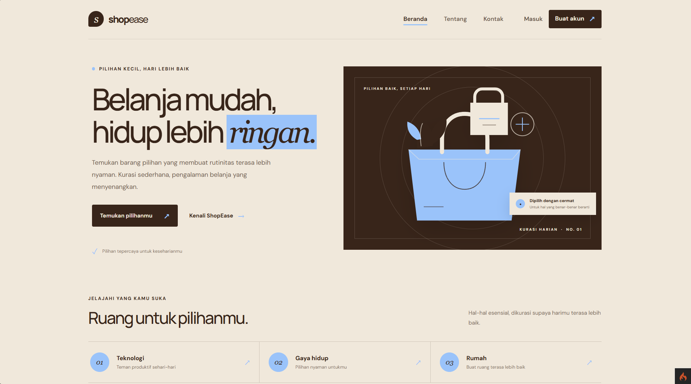

- Halaman daftar dengan formulir kosong.

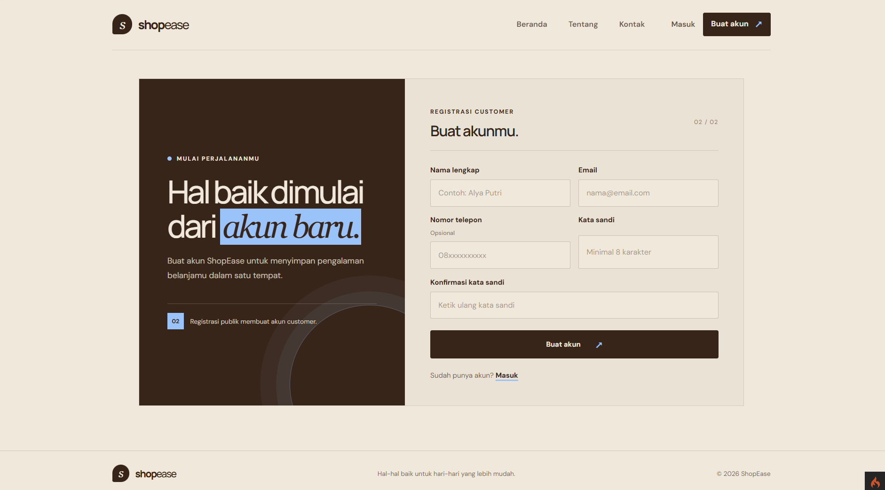

- Validasi saat data wajib belum lengkap atau email sudah digunakan.

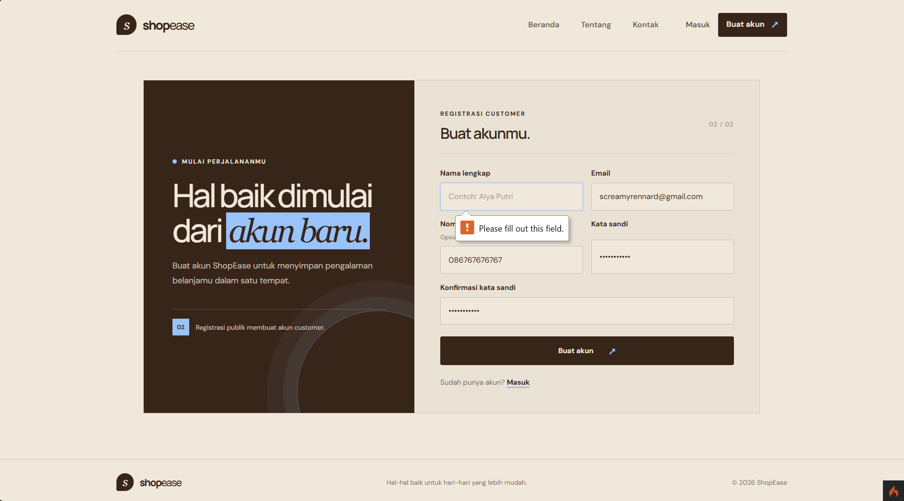

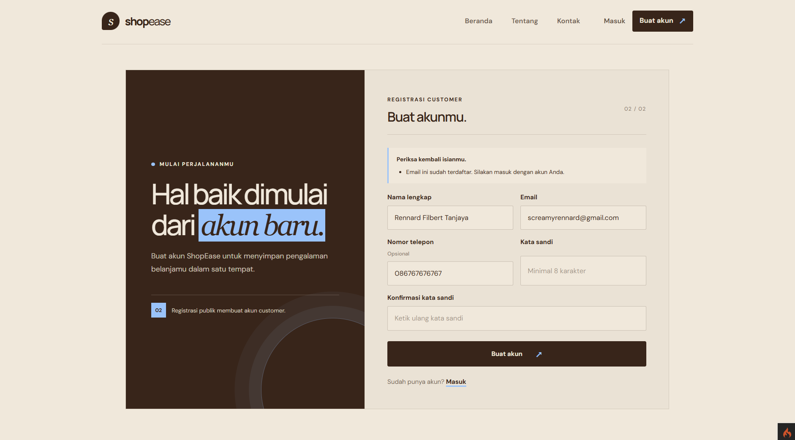

- Pesan berhasil setelah akun customer dibuat.


### Login dan akun customer

- Halaman login.

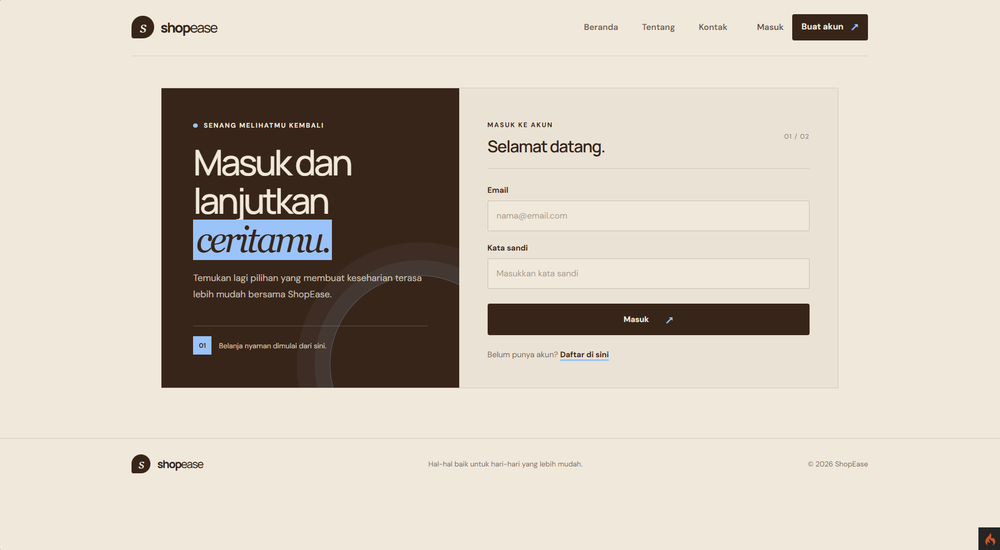

- Pesan ketika email atau kata sandi tidak cocok.

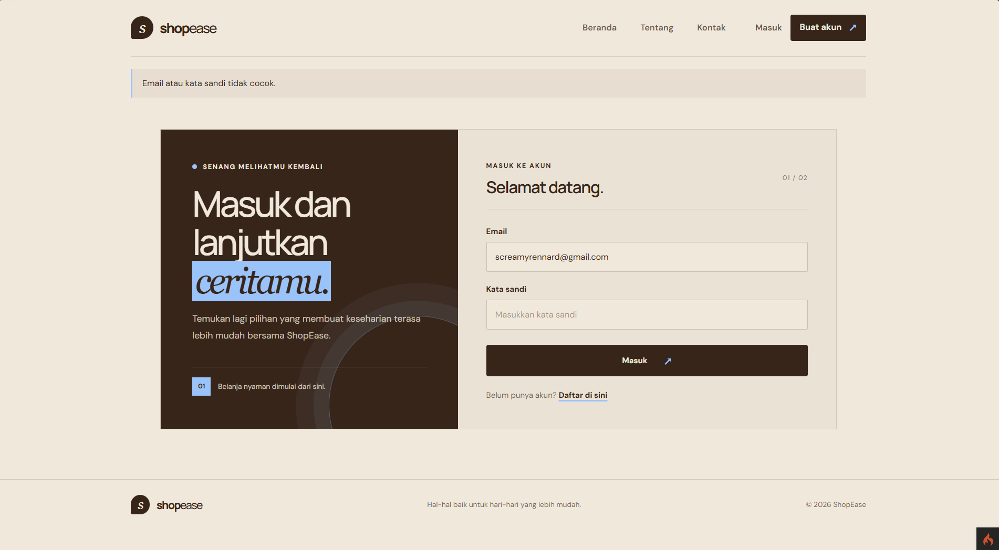

- Halaman akun setelah customer berhasil login.

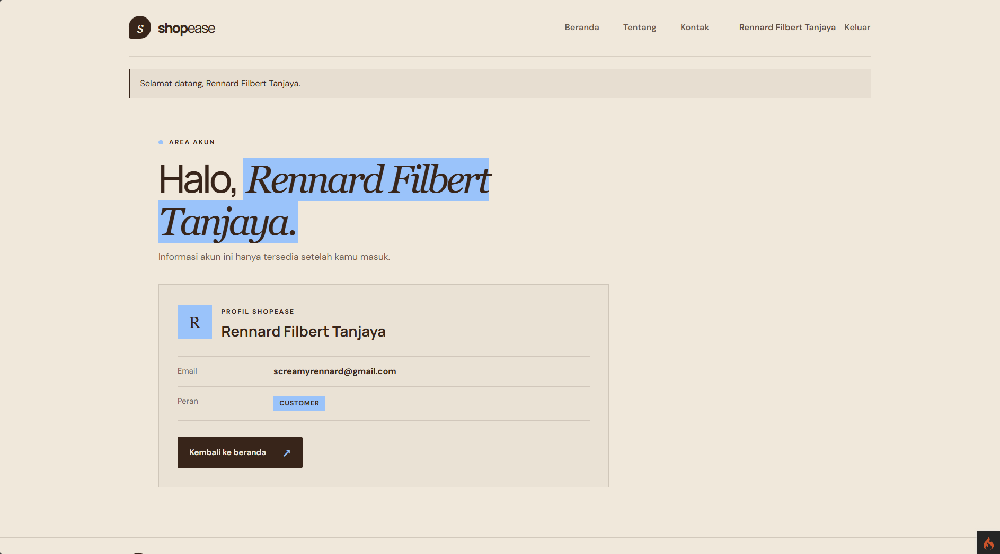

- Halaman setelah customer keluar dan pesan konfirmasi muncul.

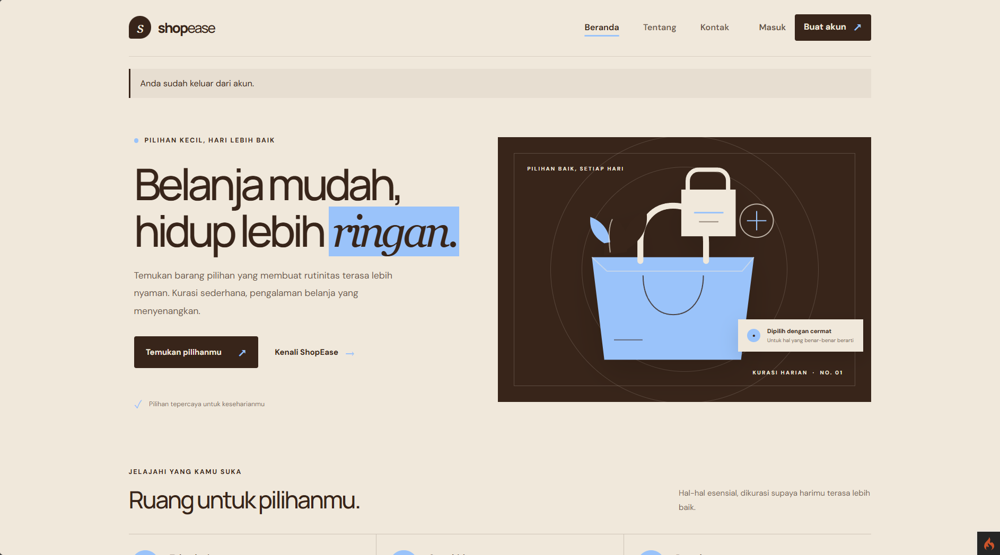

### Hak akses berdasarkan role

- Halaman `/admin/dashboard` setelah login dengan akun admin demo.

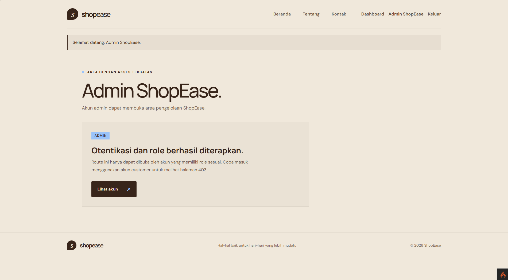

- Halaman `/operator/dashboard` setelah login dengan akun operator demo.

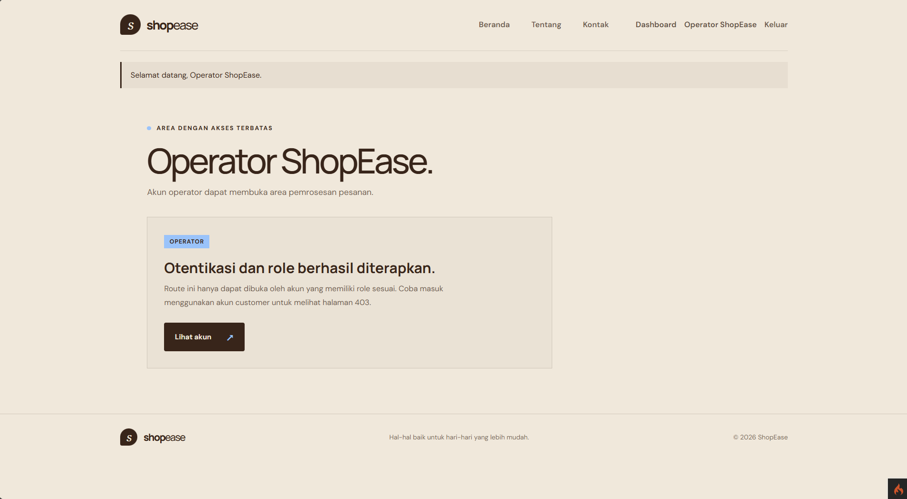

- Respons 403 ketika customer mencoba membuka `/admin/dashboard`.

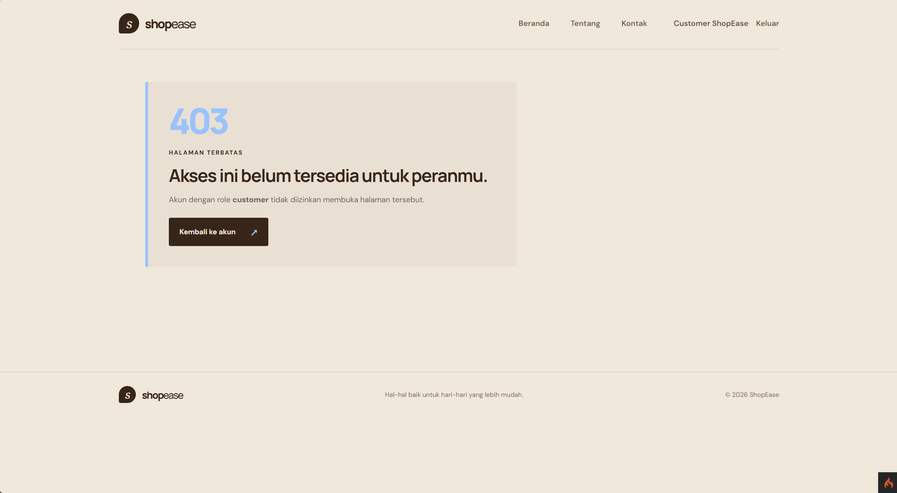

## 9. Struktur Proyek

```text
Latihan 7 - Pertemuan 11/
├── app/
│   ├── Config/
│   │   ├── Filters.php
│   │   └── Routes.php
│   ├── Controllers/
│   │   ├── AboutController.php
│   │   ├── AccountController.php
│   │   ├── AuthController.php
│   │   ├── ContactController.php
│   │   ├── DashboardController.php
│   │   └── Home.php
│   ├── Database/
│   │   ├── Migrations/
│   │   │   └── 20261116000001_CreateUsers.php
│   │   └── Seeds/
│   │       ├── DatabaseSeeder.php
│   │       └── UserSeeder.php
│   ├── Filters/
│   │   ├── AuthFilter.php
│   │   └── GuestFilter.php
│   ├── Models/
│   │   └── UserModel.php
│   └── Views/
│       ├── auth/ (login, register, akun, dan dashboard role)
│       ├── errors/html/error_403.php
│       ├── frontend/ (beranda, tentang, dan kontak)
│       ├── layouts/main.php
│       └── partials/ (navbar, footer, dan pesan status)
├── Database/
│   └── create_database.sql
├── documentation/
├── public/assets/
│   ├── css/style.css
│   └── img/
├── writable/
├── .env.example
├── .gitignore
├── composer.json
└── spark
```
