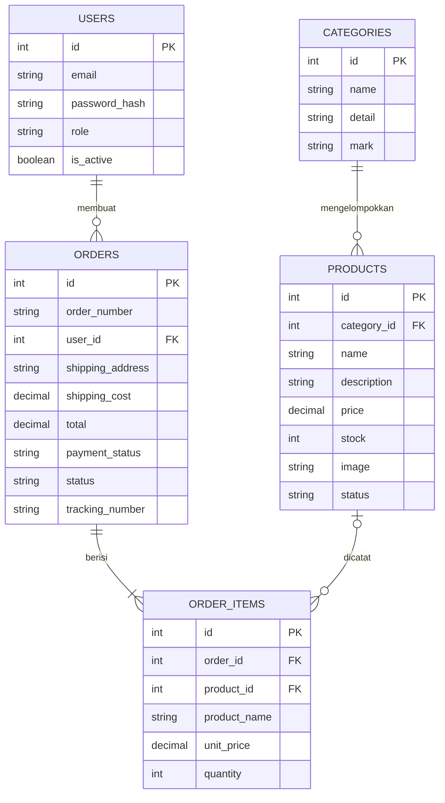

# Latihan Pertemuan 12 PBKK: CRUD, Checkout, dan Pengiriman ShopEase


| Nama | NRP | Mata Kuliah | Kelas |
|---|---|---|---|
| Willy Marcelius | 5025241096 | Pemrograman Berbasis Kerangka Kerja | D |

---

## 1. Deskripsi

**ShopEase** melanjutkan aplikasi dari Latihan 6 dan Latihan 7. Admin mengelola produk dan kategori melalui operasi **Create, Read, Update, Delete (CRUD)**. Customer dapat menyimpan produk dalam keranjang, menyelesaikan checkout, dan memantau status pengiriman. Aplikasi menggunakan CodeIgniter 4 dan Microsoft SQL Server.

Data akun dan role dari Latihan 7 tetap digunakan. Pesanan menyimpan snapshot produk, alamat penerima, ongkir, metode COD, status pembayaran, status pengiriman, dan nomor resi.

## 2. Fitur

### Pengunjung dan customer

- Melihat enam produk contoh yang dimuat dari database.
- Membuka katalog, mencari nama atau deskripsi, memilih kategori, dan mengurutkan harga.
- Melihat detail, foto, harga, stok, dan deskripsi produk aktif.
- Produk berstatus nonaktif tidak ditampilkan di katalog.
- Menambahkan produk dan mengatur jumlahnya di keranjang.
- Checkout menggunakan akun customer, memilih pengiriman reguler atau ekspres, dan membayar dengan COD.
- Melihat riwayat pesanan, alamat tujuan, status pembayaran, serta nomor resi setelah pesanan dikirim.

### Admin

- Membuat, melihat, mengubah, dan menghapus produk.
- Mengunggah foto JPG, PNG, atau WEBP dengan batas ukuran 2 MB.
- Mengaktifkan atau menonaktifkan produk.
- Membuat, melihat, mengubah, dan menghapus kategori.
- Kategori yang masih digunakan produk tidak dapat dihapus.
- Melihat pesanan dan rincian produk serta alamat pengiriman customer.
- Memperbarui status pesanan dan pembayaran; nomor resi wajib diisi sebelum status menjadi dikirim.

Katalog menggunakan data produk dari SQL Server. Saat checkout, stok diperiksa ulang dan dikurangi dalam transaksi database. Pendaftaran publik selalu menghasilkan role customer; hanya admin yang dapat membuka route pengelolaan.

## 3. Hak Akses dan Route

| Role | Hak akses |
|---|---|
| Pengunjung | Beranda, Tentang, Kontak, katalog, detail produk aktif, dan keranjang |
| Customer | Hak pengunjung, checkout, riwayat pesanan, halaman akun, dan logout |
| Admin | Halaman umum, akun, dashboard, pengelolaan produk, kategori, dan pesanan |
| Operator | Halaman umum, akun, dashboard operator, dan logout |

Route checkout dan pesanan customer memakai filter `auth:customer`. Route pengelolaan produk, kategori, dan pesanan admin memakai filter `auth:admin`. Pengunjung yang belum login diarahkan ke halaman login, sedangkan role yang tidak sesuai menerima respons 403.

| Method | URL | Fungsi | Akses |
|---|---|---|---|
| GET | `/` | Beranda dengan kategori dan produk pilihan | Umum |
| GET | `/catalog` | Katalog, pencarian, filter, dan pengurutan | Umum |
| GET | `/product/{id}` | Detail produk aktif | Umum |
| GET | `/cart` | Melihat keranjang belanja | Umum |
| POST | `/cart/add` | Menambahkan produk ke keranjang | Umum |
| PUT | `/cart/{id}` | Mengubah jumlah produk di keranjang | Umum |
| DELETE | `/cart/{id}` | Menghapus produk dari keranjang | Umum |
| GET | `/checkout` | Formulir alamat dan pengiriman | Customer |
| POST | `/checkout` | Membuat pesanan dan mengurangi stok | Customer |
| GET | `/akun/pesanan` | Riwayat pesanan customer | Customer |
| GET | `/akun/pesanan/{id}` | Detail pesanan dan status pengiriman | Pemilik pesanan |
| GET | `/admin/orders` | Daftar pesanan customer | Admin |
| GET | `/admin/orders/{id}` | Rincian pesanan dan formulir status | Admin |
| PUT | `/admin/orders/{id}` | Memperbarui status, pembayaran, dan resi | Admin |
| GET | `/admin/products` | Daftar produk dan tindakan CRUD | Admin |
| GET | `/admin/products/new` | Form tambah produk | Admin |
| POST | `/admin/products` | Menyimpan produk baru | Admin |
| GET | `/admin/products/{id}/edit` | Form ubah produk | Admin |
| PUT | `/admin/products/{id}` | Menyimpan perubahan produk | Admin |
| DELETE | `/admin/products/{id}` | Menghapus produk | Admin |
| GET | `/admin/categories` | Daftar kategori | Admin |
| GET | `/admin/categories/new` | Form tambah kategori | Admin |
| POST | `/admin/categories` | Menyimpan kategori baru | Admin |
| GET | `/admin/categories/{id}/edit` | Form ubah kategori | Admin |
| PUT | `/admin/categories/{id}` | Menyimpan perubahan kategori | Admin |
| DELETE | `/admin/categories/{id}` | Menghapus kategori yang tidak dipakai | Admin |

Semua route didaftarkan secara eksplisit di `app/Config/Routes.php`; auto-routing dinonaktifkan. Formulir perubahan menggunakan CSRF dan method spoofing CodeIgniter.

## 4. Database dan Data Awal

Aplikasi terhubung ke Microsoft SQL Server melalui driver `SQLSRV`. Migration membuat lima tabel:

| Tabel | Isi |
|---|---|
| `users` | Akun dan role dari Latihan 7 |
| `categories` | Nama, deskripsi singkat, dan penanda kategori |
| `products` | Kategori, nama, deskripsi, harga, stok, foto, dan status |
| `orders` | Customer, alamat, pilihan pengiriman, ongkir, total, pembayaran, status, dan resi |
| `order_items` | Snapshot nama, foto, harga, serta jumlah produk pada pesanan |

Satu kategori dapat memiliki banyak produk. Setiap pesanan memiliki sejumlah baris `order_items`. Snapshot produk menjaga rincian pesanan tetap tersedia meskipun produk dihapus; stok hanya berkurang setelah checkout berhasil. Migration berada di `app/Database/Migrations`.



`DatabaseSeeder` memanggil `UserSeeder` dan `ShopSeeder`. Seeder menyiapkan akun demo dari Latihan 7, tiga kategori, dan enam produk yang sama dengan pilihan pada Latihan 6. Seeder melewati data yang sudah ada agar aman dijalankan kembali.

| Role | Email | Kata sandi demo |
|---|---|---|
| Admin | `admin@shopease.test` | `Admin123!` |
| Operator | `operator@shopease.test` | `Operator123!` |
| Customer | `customer@shopease.test` | `Customer123!` |

Foto bawaan tetap menggunakan file di `public/assets/img/products`. Foto baru yang diunggah disimpan di `writable/uploads/products`; nama file dibuat acak dan file disajikan melalui route gambar produk. Folder runtime tersebut diabaikan Git.

Ongkir lokal bersifat tetap untuk latihan: reguler Rp 15.000 dengan estimasi 3–5 hari kerja dan ekspres Rp 30.000 dengan estimasi 1–2 hari kerja. Pembayaran menggunakan COD; admin memperbarui status pembayaran setelah menerima pembayaran. Aplikasi tidak terhubung ke payment gateway atau API kurir.

## 5. Model, Controller, dan Validasi

| Bagian | Tanggung jawab |
|---|---|
| `ProductModel` | Membaca katalog, mencari produk, dan melakukan query daftar admin |
| `CategoryModel` | Membaca dan mengelola kategori |
| `ProductController` | Menampilkan katalog dan detail produk untuk umum |
| `Admin/ProductController` | CRUD produk dan validasi gambar |
| `Admin/CategoryController` | CRUD kategori dan mencegah penghapusan kategori yang dipakai |
| `CartService` | Membaca isi keranjang session dan menghitung subtotal |
| `CheckoutController` | Checkout, validasi stok, riwayat, dan detail pesanan customer |
| `Admin/OrderController` | Melihat pesanan serta memperbarui status dan resi |
| `OrderModel` / `OrderItemModel` | Menyimpan pesanan dan snapshot produk |
| `AuthFilter` | Membatasi route checkout, customer, operator, dan admin berdasarkan role |
| `ShopSeeder` | Mengisi kategori dan enam produk awal |

Validasi produk mencakup nama, kategori, deskripsi, harga positif, stok minimal nol, status aktif/nonaktif, dan tipe serta ukuran foto. Checkout memeriksa alamat, metode pengiriman, status produk, dan ketersediaan stok sebelum menyimpan pesanan. Data yang ditampilkan di view di-escape dengan `esc()`.

## 6. Cara Menjalankan

Persyaratan:

- PHP 8.2 atau lebih baru dengan ekstensi CodeIgniter, termasuk `intl`, `mbstring`, dan `sqlsrv`
- Composer
- Microsoft SQL Server 2012 atau lebih baru
- Microsoft ODBC Driver for SQL Server

Buka terminal pada folder `Latihan 8 - Pertemuan 12`. Jika folder `vendor` belum tersedia, pasang dependensi:

```powershell
composer install
```

Jalankan `Database/create_database.sql` satu kali melalui SSMS atau editor SQL Server di VS Code. File `.env.example` mengikuti koneksi SQL Server lokal: host `localhost`, database `ShopEaseCRUDDB`, driver `SQLSRV`, port `1433`, schema `dbo`, dan Windows Authentication dengan username/password kosong. Jika `.env` belum ada, salin konfigurasi:

```powershell
Copy-Item .env.example .env
```

Jika nama instance atau metode autentikasi SQL Server Anda berbeda, ubah hostname, port, username, atau password pada `.env`. Pastikan PHP CLI memuat ekstensi `sqlsrv` dan Microsoft ODBC Driver telah terpasang. Kemudian jalankan migration, seeder, dan server:

```powershell
php spark migrate
php spark db:seed DatabaseSeeder
php spark serve
```

Buka `http://localhost:8080`. Login customer demo untuk mencoba checkout, atau login admin untuk membuka menu Pesanan, Produk, dan Kategori. Untuk melihat route, gunakan:

```powershell
php spark routes
```

## 7. Dokumentasi Tampilan

Ganti tautan kosong dengan path screenshot di folder `documentation`. Ambil screenshot hasil aplikasi saat berjalan.

### Beranda dan katalog

-  — Beranda yang menampilkan kategori dan produk awal.
-  — Katalog lengkap sebelum filter digunakan.
-  — Hasil pencarian produk dengan kategori atau urutan harga.
-  — Detail foto, deskripsi, harga, dan stok.

### Keranjang, checkout, dan pengiriman

-  — Produk di keranjang beserta pengaturan jumlah dan subtotal.
-  — Alamat penerima, pilihan pengiriman, dan pembayaran COD.
-  — Detail nomor pesanan, total, dan alamat tujuan.
-  — Status tiap pesanan pada halaman customer.
-  — Admin memperbarui status, memasukkan nomor resi, dan mengubah status pembayaran.
-  — Detail customer setelah pesanan dikirim dan nomor resi tersedia.

### CRUD produk

-  — Daftar produk di panel admin.
-  — Form produk sebelum disimpan.
-  — Produk baru yang muncul di daftar.
-  — Perubahan data produk sebelum dan sesudah disimpan.
-  — Hasil setelah produk dihapus.
-  — Produk nonaktif tetap tampak untuk admin dan tidak ada di katalog publik.

### CRUD kategori dan hak akses

-  — Daftar kategori dan jumlah produk di setiap kategori.
-  — Form kategori.
-  — Daftar kategori yang menunjukkan label "Dipakai" untuk kategori berisi produk.
-  — Respons 403 saat customer mencoba membuka `/admin/products`.

## 8. Struktur Proyek

```text
Latihan 8 - Pertemuan 12/
├── app/
│   ├── Config/Routes.php
│   ├── Controllers/
│   │   ├── Admin/
│   │   │   ├── CategoryController.php
│   │   │   ├── OrderController.php
│   │   │   └── ProductController.php
│   │   ├── CartController.php
│   │   ├── CheckoutController.php
│   │   ├── ProductController.php
│   │   └── ProductImageController.php
│   ├── Libraries/CartService.php
│   ├── Database/
│   │   ├── Migrations/
│   │   │   ├── CreateCategories.php
│   │   │   ├── CreateProducts.php
│   │   │   ├── CreateOrders.php
│   │   │   └── CreateOrderItems.php
│   │   └── Seeds/
│   │       ├── DatabaseSeeder.php
│   │       ├── ShopSeeder.php
│   │       └── UserSeeder.php
│   ├── Models/
│   │   ├── CategoryModel.php
│   │   ├── OrderItemModel.php
│   │   ├── OrderModel.php
│   │   ├── ProductModel.php
│   │   └── UserModel.php
│   └── Views/
│       ├── admin/ (kategori, pesanan, dan produk)
│       └── frontend/ (cart, checkout, katalog, detail, dan pesanan)
├── Database/create_database.sql
├── documentation/
├── public/assets/
│   ├── css/style.css
│   └── img/products/
├── writable/uploads/products/ (dibuat saat foto diunggah)
├── .env.example
├── .gitignore
├── composer.json
└── spark
```

